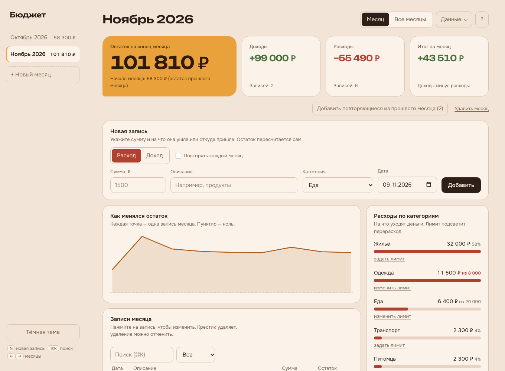

<div align="center">

# Бюджет

**Личный бюджет на компьютере: доходы, расходы, лимиты, цели и напоминания.**<br>
Без аккаунтов и облака. Все данные остаются у вас.

[](https://github.com/nemira-dodep/budget/releases/latest)
[](https://github.com/nemira-dodep/budget/releases/latest)
[](LICENSE)

<picture>
  <source media="(prefers-color-scheme: dark)" srcset="docs/screenshot-dark.png">
  
</picture>

</div>

## Скачать

Откройте [последний релиз](https://github.com/nemira-dodep/budget/releases/latest) и выберите файл:

| Система | Файл | Размер |
|---|---|---|
| macOS (Apple Silicon и Intel) | `Budget_*_universal.dmg` | около 8 МБ |
| Windows 10 и 11 | `Budget_*_x64-setup.exe` (или `.msi`) | около 3 МБ |

Дальше приложение обновляется само. Что нового в каждой версии, смотрите в [списке изменений](CHANGELOG.md).

<details>
<summary><b>Система предупреждает при первом запуске. Это нормально</b></summary>

<br>

Приложение пока не подписано сертификатом разработчика (он платный), поэтому macOS и Windows настороженно относятся к первому запуску. Код открыт, собирается в GitHub Actions, и его можно проверить.

**macOS.** Перетащите приложение в «Программы». В первый раз откройте его правым кликом → «Открыть». Если macOS пишет, что файл повреждён, выполните в Терминале:

```bash
xattr -cr /Applications/Budget.app
```

**Windows.** В окне SmartScreen нажмите «Подробнее» → «Выполнить в любом случае».

</details>

## Что умеет

| | |
|---|---|
| **Месяцы и остаток** | Остаток каждого месяца переходит в следующий. Плитки с остатком, доходами, расходами и итогом, график по записям. |
| **Быстрый ввод** | Сумма, описание, категория, дата. Клавиша `N` открывает форму, `⌘K` или `Ctrl+K` поиск, `←` `→` переключают месяцы. |
| **Свои категории** | Выберите «+ Своя категория…» в любом списке или откройте «Данные → Категории»: добавить, переименовать, удалить. |
| **Повторяющиеся записи** | Отметьте зарплату или аренду «каждый месяц», и они подставятся в новый месяц. |
| **Лимиты и цели** | Потолок трат по категории с подсветкой перерасхода. Цели накопления с прогрессом. |
| **Напоминания** | Системные уведомления, разовые или ежемесячные. Приложение живёт в трее и напоминает даже с закрытым окном. |
| **Импорт и экспорт** | Справка Т-Банка в `.pdf`, таблицы `.xlsx`, `.xls`, `.csv` на вход, CSV на выход, резервная копия в `.json`. |
| **Обновления** | Проверка при запуске и раз в 6 часов, установка одной кнопкой. |
| **Вид** | Тёплые светлая и тёмная темы, адаптивный интерфейс, работает без интернета. |

## Как начать

1. Откройте приложение. На первом экране три шага «С чего начать».
2. Укажите **стартовый остаток**: сколько денег у вас сейчас.
3. Добавьте первую запись в блоке «Новая запись».
4. Остальное считается само. Кнопка `?` в углу открывает короткую справку.

## Где лежат данные и как их сохранить

Данные хранятся в файле `data.json` в папке данных приложения (на macOS это `~/Library/Application Support/ru.nemira.budget`, на Windows `%APPDATA%\ru.nemira.budget`). Они никуда не отправляются.

Раз в день приложение само делает копию и хранит последние 30. Папку копий можно сменить и открыть в меню **Данные → Папка копий** и **Данные → Открыть папку копий**. Выберите папку в iCloud Drive или Dropbox, и копии переживут поломку диска. Если файл данных повредится, приложение предложит восстановить последнюю копию, а повреждённый файл останется рядом как `data.json.broken`.

Вручную: **Данные → Сохранить копию** создаёт файл `.json`, а **Данные → Загрузить копию** возвращает его. Это удобно при переносе на другой компьютер.

## Импорт банковской выписки

Банки не дают программам доступ к личным счетам, поэтому данные берутся из файла выписки. Сейчас поддерживается **«Справка о движении средств» Т-Банка в PDF**.

1. В приложении или кабинете Т-Банка закажите «Справку о движении средств» за нужный период и скачайте PDF.
2. В Бюджете откройте **Данные → Импорт из файла** и выберите PDF.
3. Проверьте список: у каждой операции видна категория, её можно поменять. Исправление запомнится для этого магазина.
4. Нажмите **Импортировать**.

**Что важно знать**
- Переводы между вашими собственными договорами по умолчанию пропускаются (они не доходы и не расходы). Если нужно, включите галочку.
- Повторная загрузка той же справки ничего не удвоит.
- Если сумма прочитанного не совпадает с итогами в справке, приложение предупредит.
- Файл читается только на вашем компьютере и нигде не сохраняется. Телефоны и номера договоров сокращаются до последних 4 цифр.
- Другие банки добавляются по образцу их выписок.

## Импорт из таблицы

Откройте **Данные → Импорт из файла** и выберите `.xlsx`, `.xls` или `.csv`. Приложение ищет колонки «доход», «расход», «дата», «описание», а строки вида «НОЯБРЬ 2026» воспринимает как начало месяца. Перед импортом покажет, что нашлось, и пропустит дубли.

## Для разработчиков

Приложение на [Tauri 2](https://tauri.app): оболочка на Rust, интерфейс на HTML, CSS и JS без сборки.

**Нужно:** [Node.js](https://nodejs.org) 20+, [Rust](https://rustup.rs) и [зависимости Tauri](https://tauri.app/start/prerequisites/) для вашей системы.

```bash
npm install
npm run dev      # запуск приложения
npm run build    # установщик для вашей системы
npm test         # тесты логики (Node) и оболочки (Rust)
```

Интерфейс можно открыть и в браузере, без Tauri. Сохранение файлов тогда идёт через браузер, а уведомления и обновления не работают:

```bash
python3 -m http.server 8000 --directory web
```

<details>
<summary>Структура проекта</summary>

```
web/                 интерфейс
  index.html
  style.css
  app.js
  core.js            деньги, формат данных, подсчёт (без интерфейса, покрыт тестами)
  storage.js         чтение и запись данных
  fonts/             Onest и Unbounded (офлайн)
  statement.js       разбор банковской выписки и категории (без интерфейса, покрыт тестами)
  vendor/            SheetJS и pdf.js для импорта (грузятся только при импорте)
src-tauri/           оболочка: окно, трей, уведомления, диалоги файлов, обновления
  src/main.rs
  tauri.conf.json
.github/workflows/   сборка для macOS и Windows
CHANGELOG.md         список изменений, его текст идёт в описание релиза
```

</details>

<details>
<summary>Как выпустить версию</summary>

1. Добавьте раздел `## X.Y.Z — дата` в [CHANGELOG.md](CHANGELOG.md).
2. Поднимите версию в `package.json`, `src-tauri/Cargo.toml` и `src-tauri/tauri.conf.json`.
3. Сделайте коммит, затем тег и отправьте его:

```bash
git tag vX.Y.Z
git push && git push --tags
```

GitHub Actions соберёт установщики для macOS и Windows, подпишет обновления и опубликует релиз. Описание релиза берётся из `CHANGELOG.md`. Для проверки без релиза запустите workflow **Build** вручную (Actions → Build → Run workflow).

**Ключ подписи обновлений.** Публичный ключ лежит в `src-tauri/tauri.conf.json` (`plugins.updater.pubkey`). Приватный ключ и пароль хранятся в секретах репозитория `TAURI_SIGNING_PRIVATE_KEY` и `TAURI_SIGNING_PRIVATE_KEY_PASSWORD`. Создать пару заново можно командой `npx tauri signer generate -w ~/.tauri/budget.key`. Если потерять ключ, уже установленные копии перестанут обновляться.

</details>

## Лицензия

[MIT](LICENSE). Библиотека [SheetJS Community Edition](https://sheetjs.com) в `web/vendor` и [pdf.js](https://mozilla.github.io/pdf.js/) в `web/vendor/pdfjs` распространяются по Apache-2.0. Шрифты [Onest](https://fonts.google.com/specimen/Onest) и [Unbounded](https://fonts.google.com/specimen/Unbounded) в `web/fonts` по SIL OFL 1.1.
